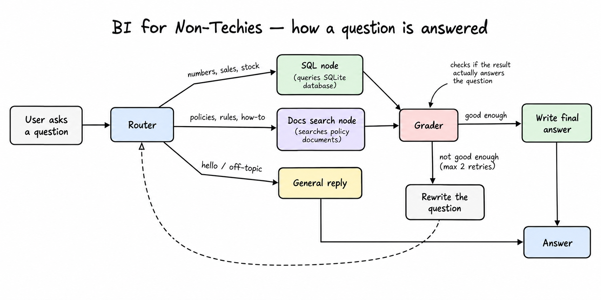
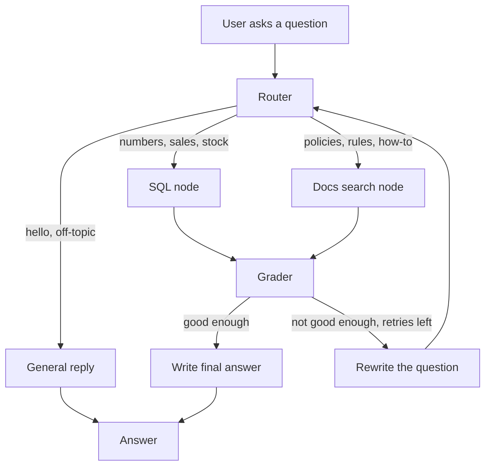

# BI for Non-Techies

Ask questions about a retail business in plain English and get answers back. No SQL, no dashboards.

For example:

- "What were total sales in Chennai last month?"
- "Which stores are out of stock in Grocery & Staples?"
- "What is the refund timeline for a COD order?"

The app works out what kind of question it is, then either queries the sales database or looks it up in the company policy documents.

> The data is made up. It's a sample Indian retail chain (stores, orders, customers, returns, inventory) plus 11 policy documents (returns, GST, pricing, loyalty, etc.). It isn't connected to any real company.

---

## How it works



<details>
<summary>Text version of the flowchart</summary>



</details>

In plain words:

1. **Router** reads the question and picks one of three paths.
2. **SQL node** turns the question into a SQL query and runs it on the SQLite database.
3. **Docs search node** finds the most relevant parts of the policy documents (ChromaDB + embeddings).
4. **Grader** checks whether what came back actually answers the question.
5. If it doesn't, the **rewriter** rephrases the question and tries again (up to 2 times).
6. **Generator** writes the final answer in simple language.

Conversation history is saved per `thread_id`, so follow-up questions work.

---

## Tech used

- **LangGraph** for the step-by-step flow above
- **LangChain** for talking to the LLM
- **Groq** (free hosted API) or **Ollama** (runs locally) as the LLM
- **SQLite** for the sales data
- **ChromaDB** + `all-MiniLM-L6-v2` for document search
- **FastAPI** for the API
- **Docker** (optional)

---

## Project layout

```
app/        FastAPI app and settings
core/       database, LLM, embeddings, vector store helpers
graph/      the LangGraph flow: state, nodes, tools, workflow
data/       policy documents and the database schema
scripts/    set up the DB, load documents, smoke test
docs/       architecture notes, demo questions, troubleshooting
cli.py      chat with it in the terminal
```

---

## Getting started

You need **Python 3.11+**, and either a free [Groq API key](https://console.groq.com/keys) or [Ollama](https://ollama.com) installed.

**1. Clone and install**

```bash
git clone https://github.com/<your-username>/bi-for-non-techies.git
cd bi-for-non-techies
python -m venv .venv
source .venv/bin/activate
pip install -r requirements.txt
```

**2. Add your settings**

```bash
cp .env.example .env
```

Open `.env` and either:

- set `LLM_PROVIDER=groq` and paste your `GROQ_API_KEY`, or
- set `LLM_PROVIDER=ollama` and run `ollama pull llama3.1` first.

**3. Create the database and load the documents**

```bash
make setup
make ingest
```

**4. Start it**

Chat in the terminal:

```bash
make chat
```

Or run the API:

```bash
make run
```

Then open http://localhost:8000/docs to try it in the browser.

---

## Using the API

```bash
curl -X POST http://localhost:8000/query -H "Content-Type: application/json" -d '{"question": "Top 5 categories by revenue in FY25-26"}'
```

You get back the answer plus some details about how it got there:

```json
{
  "question": "Top 5 categories by revenue in FY25-26",
  "query_type": "sql",
  "answer": "...",
  "is_relevant": true,
  "relevance_score": 0.9,
  "retries": 0,
  "thread_id": "...",
  "model": "openai/gpt-oss-120b"
}
```

Pass the same `thread_id` again to continue the conversation.

| Endpoint | What it does |
|----------|--------------|
| `POST /query` | Ask a question |
| `POST /ingest` | Reload the policy documents |
| `GET /history/{thread_id}` | See a past conversation |
| `GET /health` | Check the server is up |

---

## Running with Docker

```bash
make docker-up
```

Stop it with `make docker-down`. If you use Ollama, keep it running on your machine. The container connects to it there.

---

## Things to try

There's a list of 26 sample questions in [docs/DEMO_QUESTIONS.md](docs/DEMO_QUESTIONS.md). To run a quick check across them:

```bash
make smoke
```

---

## Known limitations

- Each question goes down **one** path only. A question that needs both the database and a policy doc (e.g. "Is our Bengaluru return rate within policy limits?") won't be fully answered yet.
- Smaller local models sometimes pick the wrong path or write bad SQL.
- Hinglish questions are hit and miss.
- The database is read-only. Only `SELECT` queries are allowed.

---

## More docs

- [Architecture](docs/ARCHITECTURE.md)
- [Build guide](docs/BUILD_GUIDE.md)
- [Troubleshooting](docs/TROUBLESHOOTING.md)
